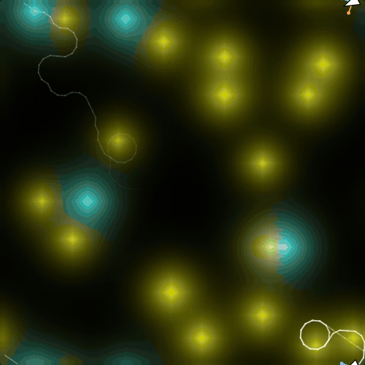
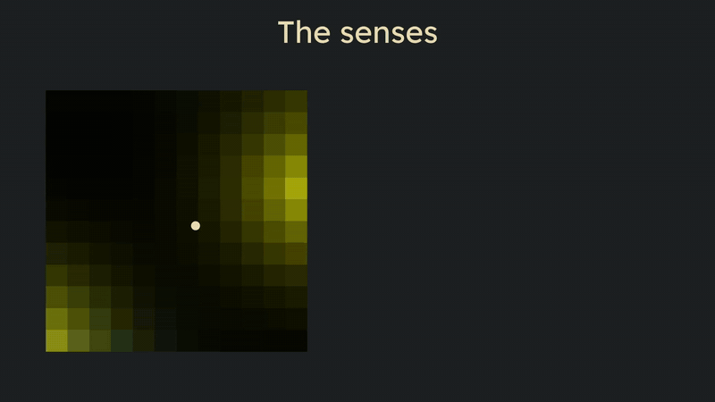
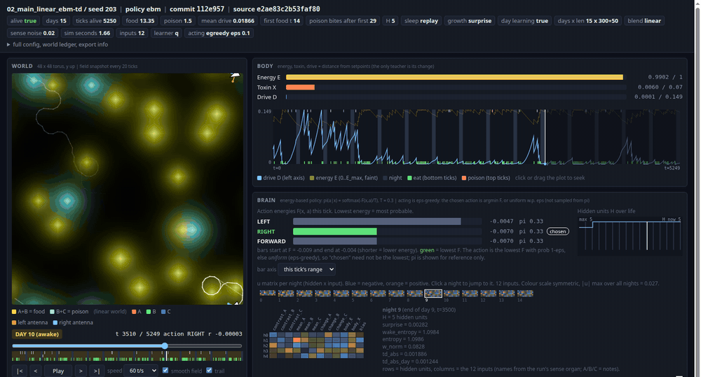
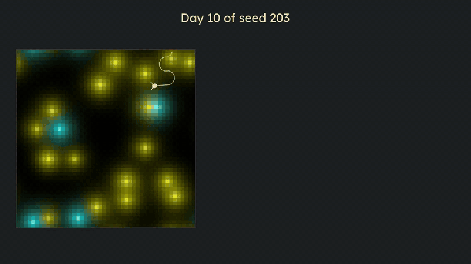
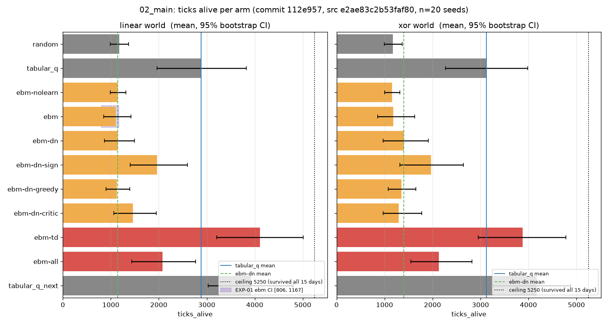
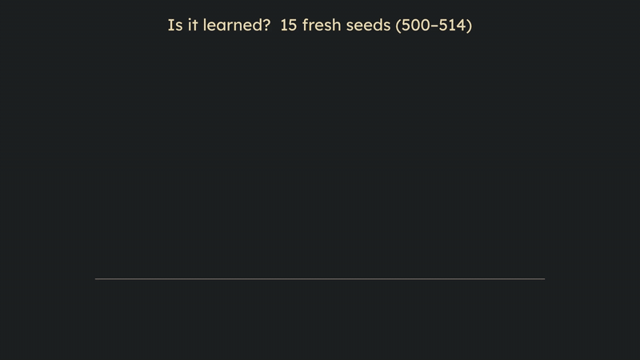

# EBM lab

A playground for learning energy-based models deeply, by building Ahmed's idea: a growing network of
small energy-based models whose job is to make connections, that caches what it did during the day and
retrains during sleep, generation after generation. See `IDEA.md`.

Started 2026-10-13. Separate from Genesis: `~/genesis-archive` is a read-only research library we draw
knowledge from. No Genesis code is carried over.

<p align="center"></p>

## What this is, in plain words

A tiny creature lives in a 48 x 48 world full of smells. It has two antennae, a body that gets hungry,
and a brain made of a small **energy-based model**. Nobody tells it what food is. The only teacher is
its own body: eating makes it feel better, starving and poison make it feel worse. The question of the
lab is simple: **can a brain like this learn, within one life, to find food by smell?**

As of EXP-02, the answer is **yes**.

### The world and the senses



- Food and poison leak three chemical "notes" (A, B, C) that spread and fade. **Food smells of A + B,
  poison of B + C.** So no single note tells them apart.
- Each tick the creature reads the six numbers under its two antenna tips, and turns them into 12
  inputs: which side smells stronger, how strong overall, what changed since last tick, and how its
  body feels.
- It can do three things: turn **left**, turn **right**, or go **forward**.

### The brain

Every possible move gets an **energy**, `F(x, a)`. Lower energy means "this move fits what I sense right
now". The creature picks the lowest-energy move 90% of the time, and a random one the other 10%, so it
keeps exploring.

Learning means reshaping that energy. The rule that worked (arm `ebm-td`) treats `-F` as a guess of how
good each move is, and nudges it toward what actually happened: **every tick while awake, and again at
night by replaying what it did during the day.** When a day surprises it, it grows a new hidden unit.

### Watch it live

The run viewer replays a whole life from the log: the world, the body's energy and toxin, and the
brain's energy for each move, tick by tick. This is day 10 of seed 203:



And the same day, from the teaching video:



### The result


20 creatures, 15 days each (5250 ticks is the most a creature can live):

- The value-learning brain (`ebm-td`) lives **4113 ticks** on average in the linear world and **3876** in the xor world.
  **15 of 20** creatures survive the whole 15 days.
- It **reaches the level of tabular Q-learning**, the classic textbook baseline. It does **not** clearly beat it.



### Did it really learn?



Take one creature's brain from day 5, **freeze it**, and drop it into 15 new worlds:

- the day-5 brain survives **15 / 15**
- the same brain with its **antennae swapped** left for right survives **0 / 15**
- the brain it was born with survives **2 / 15**

So the skill lives in the weights, and it depends on knowing left from right.

### What it does not do (yet)

- It does **not avoid poison**. The survivors simply eat more food.
- The hidden units are not what makes it work. The xor world does not yet force the creature to combine notes.
- The full list, with every correction kept on record, is in [`findings/02`](findings/02_exp02_decomposition.md).

### How the lab works

Every experiment is **pre-registered** (written and committed before it runs). Every conclusion gets
**two hostile referees** whose job is to break it. When a claim turns out wrong, the correction is added
and the old claim stays visible (see `findings/01` and `research/07`).

### Try it yourself

```
uv sync
uv run pytest                              # the 83 laws the simulation must obey
uv run python weights/try_it.py            # drop the trained brain into a new world
uv run python -m http.server 8765          # then open the viewer link it prints
```

The trained weights and an honest table of how well they do in new worlds are in [`weights/`](weights/).

A full teaching video (lesson 01, about an hour, every number in the brain explained) is coming.


## Layout

| Path | What |
|---|---|
| `IDEA.md` | the idea, verbatim, and its parts |
| `RESEARCH-PLAN.md` | the goal, hypotheses H1–H5, phases (v0.1; the creature-first reorder is in session 02's journal) |
| `DESIGN.md` + `DESIGN-AMENDMENTS.md` | creature v0's spec, and every change to it with its reason |
| `creature/` | the code: physics, world, body, senses, brain (EBM), baselines, sim, run, export |
| `tests/` | the laws (`uv run pytest`) |
| `experiments/` | harness, calibration, pilots, pre-registrations, `results/` (json + png) |
| `viewer/` | the run viewer (see its README) |
| `runs/` | exported lives to watch |
| `docs/media/` | the pictures and clips in this README |
| `weights/` | the trained brains (final weights of seed 203, both worlds) + `try_it.py` to drop one into a new world |
| `CLAUDE.md` | ground rules for any agent working here |
| `STATE.md` | where the lab is right now (updated every session) |
| `HANDOFF.md` | what the next session does first |
| `research/genesis-digest/` | what Genesis learned, distilled and cited (A-E + `00-SYNTHESIS.md`) |
| `research/` | research seats R1–R4 (`03`–`06`), the proof-of-possibility note `07` with its scripts |
| `experiments/` | one folder per experiment, each with its own question, code, and results |
| `decisions/` | numbered decision records |
| `findings/` | durable results, each with the command that re-derives it (`01` negative, `02` the first positive learning result) |
| `sessions/` | one journal per session |
